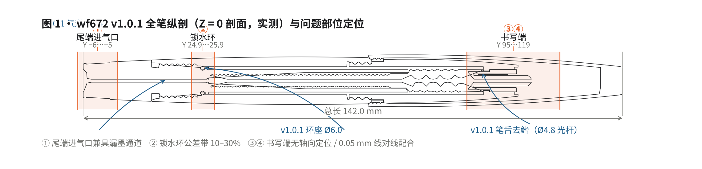
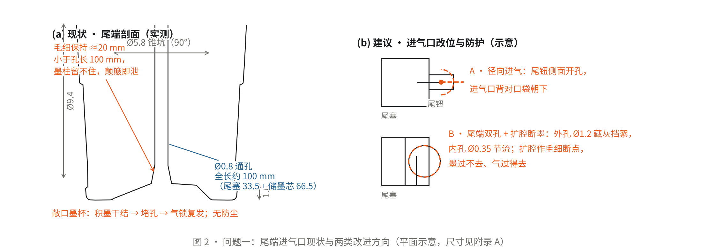
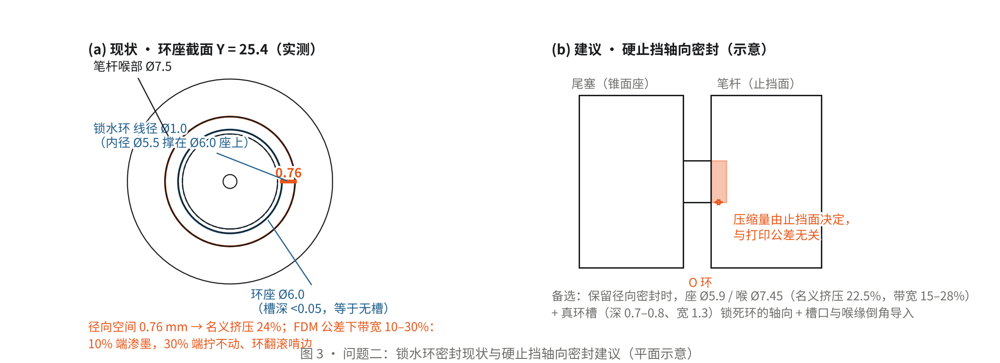
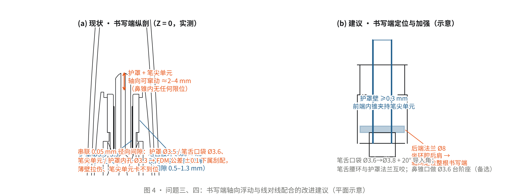

# wf672 v1.0.2 前瞻报告

> **文档编号** WF672-R-2026-012 · **版本** V1.0 · **日期** 2026-10-20 · **状态** 已发布（GitHub Release）
> **分析对象** wf672 v1.0.1（Release STL，11 壳体 / 9 零件） · **许可** CC BY 4.0
> PDF 版（含全部图版）：[Releases · v1.0.2-outlook](https://github.com/Xarfa/White-Feather-Fountain-Pen/releases/tag/v1.0.2-outlook)

**结构实测与日常使用问题分析 · Structural Survey and Daily-Use Issue Analysis**

## 摘要

wf672 v1.0.1 完成了三项针对性修复——新增 Ø0.8 气道、收紧锁水环座（Ø5.5→Ø6.0）、笔舌删除 20 片鳍片，均指向 v1.0.0 已确认的病根，方向正确。本报告在 v1.0.2 开发前，对 v1.0.1 发布模型进行逐站剖切实测复核，从日常使用视角识别出四个残留的结构问题：① 尾端进气口兼具漏墨通道；② 锁水环密封挤压率公差带过宽（10%–30%）；③ 书写端（护罩 + 笔尖单元）无轴向定位；④ 护罩 0.10 mm 薄壁与两处 0.05 mm 线对线配合。报告逐一给出机理分析与改进建议，并按优先级汇总为 v1.0.2 动作清单（第 4 节）。

## 1 概述

### 1.1 目的

wf672 v1.0.1 针对 v1.0.0 解析报告确认的三项缺陷（笔舌键合断裂、锁水环零压缩、气锁）实施了修复。本报告的目的，是在 v1.0.2 结构迭代之前，对 v1.0.1 进行一次完整的实测复核：确认三处修复的落地状态，并识别仍在日常使用中暴露的残留问题，为 v1.0.2 提供按优先级排序的改进依据。

### 1.2 对象与方法

分析对象为 GitHub Release 发布的 `wf672_v1.0.1.stl`：总长 142.0 mm，最大外径 Ø13.7 mm（笔握），含笔夹 Z 向 17.1 mm，共 11 个壳体 / 9 个设计零件，STL 出厂即为戴帽总装位姿。

方法：沿笔轴对模型进行约 60 个站位的横剖与纵剖测量，提取全部内腔轮廓、配合尺寸与特征位置；与 v1.0.0 解析报告、v1.0.1 变更图（change plate）交叉验证。文中尺寸均为实测网格值（±0.02 mm）。坐标约定：笔轴 = Y；尾端面 Y = −6，护罩尖 Y = +118.2，笔夹端 Y = +136。

### 1.3 结论摘要

v1.0.1 三处修复均已确认落地。实测识别四个残留问题，按严重程度排序见表 1。问题一、二直接影响密封与供墨可靠性，列为 P0；问题三、四影响书写端稳定性与装配性，改动量小，列为 P1。

**表 1 · 残留问题汇总（按严重程度排序）**

| 编号 | 问题 | 日常使用表现 | 严重程度 |
|---|---|---|---|
| ① | 尾端进气口兼具漏墨通道 | 尾面积墨渍；随身携带（尖朝上）时渗墨；孔道堵塞则气锁复发 | 高 |
| ② | 锁水环密封挤压率公差带过宽 | 批次内有的渗墨、有的拧不动；补墨数次后环老化 | 高 |
| ③ | 书写端无轴向定位 | 笔尖露出长度不稳、按压回缩、护罩晃动 | 中 |
| ④ | 护罩薄壁与线对线配合 | 装配刮涩、薄壁拉伤、笔尖单元夹持不可靠 | 中 |

## 2 v1.0.1 结构实测概要

wf672 为尾蘸式（wipeless）毛细储墨结构：拔出滚花尾塞，储墨芯随尾塞整体拔出，以芯端蘸墨后插回旋紧；墨量由储墨芯与尾塞套管之间的毛细通道保持，书写时空气经尾端气路回补，墨经"储墨腔 → 储墨芯前端集墨喇叭 → 笔舌墨道 → 护罩缝"到达笔尖。图 1 为全笔纵剖（Z = 0 剖面，实测）。

### 2.1 v1.0.1 三处修复的实测确认

1. **气道**：尾端面 90° 锥坑（Ø5.8 × 1.0）接 Ø0.8 通孔，贯穿尾塞（Y −6→27.5，33.5 mm）与储墨芯（Y 27.5→94，66.5 mm），经储墨芯前端集墨喇叭（Ø5.4）接入笔舌墨道（Ø0.82，Y 96.85→115.92），形成自尾端至笔尖的连续气路，全长约 100 mm。
2. **锁水环**：环座由 Ø5.5 加深至 Ø6.0，配笔杆喉部 Ø7.5 与 Ø1.0 线径橡胶环，径向空间 0.76 mm，名义挤压率 24%（v1.0.0 为 0%，即完全不密封）。
3. **笔舌**：删除 20 片鳍片，改为 Ø4.8 光杆（内孔 Ø3.6），保留集墨喇叭、椭圆腰环（5.86 × 4.9）与鼻锥；面数由 10,800 降至 4,538，与笔握内花的线对线键合风险随之消除。

### 2.2 关键配合尺寸

**表 2 · 关键配合副实测尺寸**

| 配合副 | 实测尺寸 | 径向间隙 | 备注 |
|---|---|---|---|
| 储墨芯五瓣棒 — 尾塞套内壁 | 瓣顶 Ø4.01 / 瓣谷 Ø2.8 | 0.5–1.1（收敛） | 主储墨腔，五条楔形毛细通道 |
| 锁水环 — 环座 / 喉部 | 座 Ø6.0 / 喉 Ø7.5 / 线径 Ø1.0 | 0.76（挤压 24%） | 公差带 10–30%；槽深 <0.05 |
| 笔舌光杆 — 笔握内孔 | Ø4.8 / Ø5.2 | 0.20 | 原花键座已随去鳍消失 |
| 笔舌腰环 — 笔握环腔 | 5.86 × 4.9 / Ø7.6–9.5 | 0.5–1.3 | 仅两点接触环腔后肩 |
| 护罩 — 笔舌口袋 | Ø3.5 / Ø3.6 | 0.05 | 线对线，刮配风险 |
| 暗尖单元 — 护罩内孔 | 约 Ø3.2 / Ø3.3 | 0.05 | 线对线，刮配风险 |
| 护罩 — 笔握鼻锥 | Ø3.5 / Ø7.2→Ø5.4 | 约 1.0 | 轴向无限位（问题③） |

## 3 问题分析

以下四节按"日常使用现象 — 机理与实测 — 影响 — 改进建议"组织。"日常使用现象"以使用者视角描述可观察的行为，作为结构改进的人本依据；"机理与实测"给出几何与量化证据。

### 3.1 问题一：尾端进气口兼具漏墨通道

**日常使用现象。** 补墨插回尾塞后，尾端面锥坑内易残留墨渍；钢笔置于衬衫口袋等尖朝上的携带姿态时，墨可沿 Ø0.8 通孔渗出至尾面，污染口袋与手指；该通孔同时是全笔唯一进气通道，一旦被干墨或絮毛堵塞，气锁复发、供墨中断——与 v1.0.0 同源的失效模式，仅路径不同。

**机理与实测。** 气路入口直接开设于尾端面，为一根连续约 100 mm 的 Ø0.8 通孔（尾塞段 33.5 mm + 储墨芯段 66.5 mm），全路径无阀、无滤、无毛细断点。按墨水表面张力 γ ≈ 0.04 N/m 估算，Ø0.8 圆孔的毛细保持高度约 20 mm，远小于孔道长度：补墨时墨由集墨喇叭灌入芯孔，仅前段 20~37 mm 可被毛细保持，其余孔壁在笔身颠簸、翻转时成为泄墨通路。尾端面 90° 锥坑（Ø5.8 × 1.0）构成敞口积墨腔，墨汁干结后进一步缩小有效孔径。

**影响。** ① 随身携带（尖朝上）时存在渗墨风险；② 气路单点失效，堵塞即供墨中断；③ 无防尘设计，絮毛可被书写负压吸入储墨腔。

**改进建议。** ① 首选将进气口迁离尾端面：尾钮侧面径向开孔（进气方向背对口袋），或利用笔帽遮蔽区域设置进气口（拔帽进气，帽内相对洁净）；② 若保留尾端直孔，采用"外大内小"双孔结构（外孔藏灰挡絮、内孔 Ø0.35 节流），并在锥坑与主气路之间设置局部扩腔作为毛细断点——墨不能通过、空气可以；③ 尾端面不设敞口积墨腔，锥坑改浅或配可拆防尘塞。

### 3.2 问题二：锁水环密封挤压率公差带过宽

**日常使用现象。** 同批次打印的笔中，部分尾部接缝缓慢渗墨、螺纹副内积墨；部分尾塞插拔力过大甚至无法旋合。补墨拆装数次后，橡胶环边缘出现起毛或切口，密封持续退化。

**机理与实测。** 环座 Ø6.0、笔杆喉部 Ø7.5、环线径 Ø1.0，径向空间 0.76 mm，名义挤压率 24%。但公差带下挤压率为 10%~30%（径向间隙 0.70~0.90 mm）。FDM 成型两个配合孔的公差通常为单边 ±0.1~0.15 mm，实际挤压率在批次内离散分布：低端（约 10%）静密封比压不足导致渗墨；高端（约 30%）插拔力急剧上升，且环在推入喉部时易翻滚、啃边。此外，环座上的环槽实测槽深不足 0.05 mm（径向），不具备轴向约束功能；补墨拔塞时，环（自由外径 Ø7.5）需穿过笔杆 Ø7.4 内孔，形成刮擦与疲劳。全笔密封仅此一道橡胶圈，无冗余。

**影响。** 密封性能批次不一致；补墨循环加速环老化；低端挤压率下墨液可经环隙渗出尾接缝。

**改进建议。** ① 首选改为硬止挡的轴向密封（端面 O 环或锥面密封）：压缩量由止挡面决定，对打印公差不敏感，插拔力可控；② 保留径向密封时收窄公差带（座 Ø5.9 / 喉 Ø7.45，名义挤压 22.5%，带宽 15%~28%），并设置真环槽（深 0.7~0.8、宽 1.3）实现轴向锁死，槽口与喉部后缘倒角导入；③ 补墨拆装路径上为环设置退让槽，避免刮擦。

### 3.3 问题三：书写端无轴向定位

**日常使用现象。** 装配到位的笔，书写时笔尖露出长度不稳定，按压纸面时笔尖可回缩；护罩在笔握鼻锥内晃动，存在轻微异响；帽拔帽戴数次后笔尖位置发生变化。

**机理与实测。** 书写端由 Ø3.3~3.5 薄壁护罩（Y 98→118.2，伸出鼻孔 4.7 mm）与市售暗尖单元组成。护罩后段插于笔舌 Ø3.6 口袋内，中前段浮于笔握鼻锥内孔（Ø7.2→Ø5.4）中，径向间隙约 1 mm，轴向无任何台阶、法兰或止挡。笔舌椭圆腰环（5.86 × 4.9）仅以两点接触笔握环腔后肩（间隙 0.5~1.3 mm），且仅约束笔舌向后窜动，向前无限位。因此护罩与笔尖单元整体可前后窜动约 2~4 mm。该问题在 v1.0.0 解析报告中已有记载（"护罩轴向无定位"），v1.0.1 未涉及。

**影响。** 笔尖露出长度不可预期；按压时笔尖回缩；书写端整体晃动，影响书写稳定性与手感。

**改进建议。** ① 护罩后端增设法兰（Ø8 量级），直接坐于笔握环腔后肩，实现整根书写端的轴向定位——改动最小、效果最直接；② 或在笔握鼻锥口部加工 Ø3.6 台阶座，以护罩前端锥面配合，形成第二道定位；③ 护罩壁厚由 0.10 mm 增至 ≥0.3 mm；④ 笔舌腰环与护罩法兰互咬，使笔尖单元获得轴向与径向双重约束。

### 3.4 问题四：护罩薄壁与线对线配合

**日常使用现象。** 自行打印装配时，护罩插入笔舌后口与笔尖单元插入护罩均需施加较大力；装配后护罩内壁可见拉痕；使用一段时间后笔尖出现晃动。护罩为壁厚 0.10 mm 的 20 mm 长薄壁管，一旦拉豁，书写端整体失效。

**机理与实测。** 书写端存在两处串联的 0.05 mm 径向间隙配合：护罩外径 Ø3.5 对笔舌口袋 Ø3.6；暗尖单元（管径约 Ø3.2）对护罩内径 Ø3.3。FDM 公差 ±0.1 mm 下，0.05 mm 名义间隙属刮配——或装配困难，或切削 0.10 mm 薄壁。护罩壁厚实测 0.095~0.10 mm，且无任何加强结构。

**影响。** 装配性差；薄壁损伤风险高；笔尖单元夹持不可靠。

**改进建议。** ① 笔舌口袋扩至 Ø3.8（保留 0.15 mm 径向间隙），口袋口设 20° 导入角；② 护罩壁厚 ≥0.25~0.3 mm；③ 护罩前端改内锥（约 15°）弹性夹持笔尖单元，以弹性变形补偿公差，不依赖尺寸恰好；④ 装配顺序写入随附说明（护罩 → 笔尖单元 → 笔舌 → 笔握）。

## 4 v1.0.2 改进建议汇总

**表 3 · v1.0.2 动作清单（按优先级排序）**

| 优先级 | 改进动作 | 对应问题 | 改动量 |
|---|---|---|---|
| P0 | 尾面进气口迁至尾钮侧面径向开孔，或利用笔帽遮蔽区进气；保留直孔则改双孔（外 Ø1.2 / 内 Ø0.35）并加扩腔毛细断点，尾端面取消敞口积墨腔 | ① | 中 |
| P0 | 锁水环改硬止挡轴向密封（锥面座 + 端面止挡）；备选：座 Ø5.9 / 喉 Ø7.45 收窄带宽，加深环槽（0.7–0.8 × 1.3）并倒角导入 | ② | 中 |
| P1 | 护罩后端增加法兰（Ø8）坐于笔握环腔后肩，轴向定位整根书写端；护罩壁厚 0.10 → ≥0.3 mm | ③④ | 小 |
| P1 | 笔舌口袋 Ø3.6 → Ø3.8，口袋口 20° 导入角；护罩前端内锥（15°）弹性夹持笔尖单元 | ④ | 小 |
| P2 | 笔舌腰环与护罩法兰互咬；笔握鼻锥口做 Ø3.6 台阶座（第二道定位，备选） | ③ | 小 |
| P2 | 补墨拆装路径上为 O 环设置退让槽；装配顺序写入随附说明 | ②④ | 小 |

## 5 结论

wf672 v1.0.1 的三处修复均指向 v1.0.0 已确认的病根，实测确认全部落地，笔舌键合断裂风险已消除。本次复核识别的四个问题中：问题一（尾端进气口兼具漏墨通道）与问题二（锁水环挤压率公差带）直接影响密封与供墨可靠性，是 v1.0.2 的首要对象；问题三（书写端无轴向定位）与问题四（薄壁与线对线配合）影响书写端稳定性与装配性，改动量小、收益直接。

按第 4 节清单实施后，v1.0.2 可在不改变总体架构（尾蘸式毛细储墨 + 密封不封气）的前提下，将日常使用中的渗墨、气锁、笔尖浮动与装配刮配四类风险同时收敛。建议实施顺序为：先完成两个 P0 项并打印验证，再推进 P1 项，最后以打样件做一轮装配性与供墨实测复核。

## 附录 A 关键实测尺寸

**表 A-1 · 关键实测尺寸汇总（±0.02 mm）**

| 部位 | 实测值 |
|---|---|
| 总布置 | 总长 142.0 mm（尾端面 Y = −6，护罩尖 Y = 118.2，笔夹端 Y = 136）；最大外径 Ø13.7 mm（笔握）；含笔夹 Z 向 17.1 mm |
| 气道（v1.0.1 新增） | 尾面 90° 锥坑 Ø5.8 × 1.0 → Ø0.8 通孔（尾塞 Y −6→27.5 与储墨芯 Y 27.5→94 连续，全长约 100 mm）→ 储墨芯前端集墨喇叭 Ø5.4（Y 94→99.15）→ 笔舌墨道 Ø0.82（Y 96.85→115.92）→ 护罩 → 笔尖 |
| 锁水环 | 线径 Ø1.0、内径 Ø5.5、环座 Ø6.0、笔杆喉部 Ø7.5；径向空间 0.76 mm（名义挤压 24%，公差带 10–30%）；环槽深 <0.05 mm |
| 储墨芯 | 五瓣棒（瓣顶 Ø4.01 / 瓣谷 Ø2.8，Y 27.5→73.5）+ 环纹管（Ø6.1~6.6，Y 80→99.15）；中央 Ø0.8 通孔；前端集墨喇叭 Ø5.4 |
| 尾塞 | 尾钮（Y −6→13.5，Ø9.4→10.8，滚花）— 外螺纹（Y 13.5→18.5，根 Ø8.04 / 顶 Ø8.92）— 颈锥（Y 18.5→25.9）— 薄壁套管（Y 27.5→79.5） |
| 笔杆 | Y 12→70；外圆锥面 Ø11.1→12.56；内腔 Ø7.4；后内螺纹 Y 13.5→21，前内螺纹 Y 64→70 |
| 笔舌（v1.0.1 简化） | Y 95.35→116.12；Ø4.8 光杆（内孔 Ø3.6，Y 97→101）→ 椭圆腰环 5.86 × 4.9（Y 101.7→105.7）→ 前段 U 形导墨槽 → 鼻锥尖 Y 116.12；集墨喇叭口 Ø4.0；面数 10,800 → 4,538 |
| 笔握 | Y 64→113.5；内孔 Ø5.2（Y 99.5→101.5）→ 环腔 Ø7.6~9.5（Y 101.7→107.5）→ 鼻锥 Ø7.2→Ø5.4（Y 109→113.5，鼻孔 Y = 113.5） |
| 护罩 | Ø3.3~3.5 管、壁厚 0.095~0.10 mm、Y 98→118.21；伸出鼻孔 4.7 mm；轴向无限位 |
| 笔帽 / 笔夹 | 笔帽 Y 69→136（外锥 Ø13.7→Ø9，口部内螺纹骑笔握阳牙）；笔夹 Y 99.6→136，L 形弹片 |

---

*测量与图版由对 `wf672_v1.0.1.stl` 的逐站剖切实测生成；全部图为平面图（剖面 / 示意）。报告随 GitHub Release「v1.0.2-outlook」发布，CC BY 4.0。*
